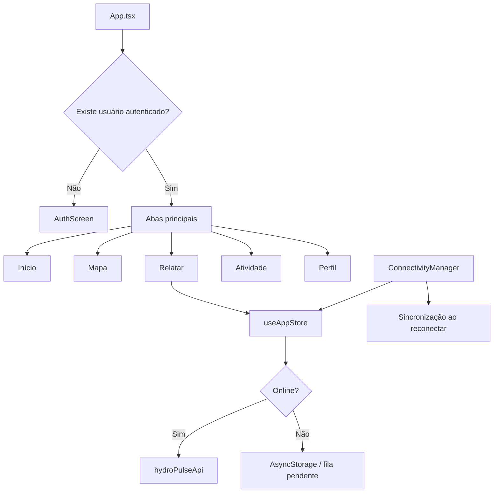

# Hydro Pulse Mobile — documentação do código

## 1. Visão geral

O Hydro Pulse é um aplicativo móvel desenvolvido com React Native, Expo e TypeScript. O protótipo permite consultar dados de chuva, visualizar relatos comunitários de alagamento, registrar novas ocorrências e manter uma fila local quando o aparelho está sem conexão.

A implementação atual usa dados simulados por padrão. A camada de serviços já está separada para permitir a conexão com uma API REST sem alterar as telas.

## 2. Tecnologias principais

| Tecnologia | Responsabilidade |
| --- | --- |
| React Native | Interface Android, iOS e web |
| Expo | Configuração, módulos nativos e empacotamento |
| TypeScript | Tipagem estática das telas, dados e navegação |
| React Navigation | Navegação por abas e pilha de telas |
| Zustand | Estado global da aplicação |
| AsyncStorage | Persistência local de contas, sessão e relatos |
| Expo Network | Detecção de conectividade |
| Expo Location | Obtenção da localização do aparelho |
| Expo Image Picker | Escolha de fotos na galeria |
| Lucide React Native | Ícones da interface |

## 3. Organização do projeto

```text
mobile/
├── App.tsx                    # Navegação principal e inicialização do app
├── app.json                   # Configuração Expo, identificadores e permissões
├── index.ts                   # Ponto de entrada
├── src/
│   ├── components/            # Componentes visuais reutilizáveis
│   ├── data/                  # Dados simulados
│   ├── screens/               # Telas da aplicação
│   ├── services/api/          # Cliente HTTP e chamadas da API
│   ├── store/                 # Estado global e persistência
│   ├── theme/                 # Cores, espaçamentos e tipografia
│   ├── types/                 # Tipos de domínio e navegação
│   └── utils/                 # Funções auxiliares de formatação
├── android/                   # Projeto Android nativo gerado pelo Expo
└── docs/                      # Documentação técnica
```

## 4. Fluxo geral da aplicação



O componente `App` consulta o usuário salvo no estado global. Sem usuário, exibe a autenticação. Com usuário autenticado, libera as abas e as telas de detalhes.

## 5. Navegação

A navegação é dividida em duas partes:

- `RootStackParamList`: telas abertas acima das abas, como detalhes, notificações e edição.
- `MainTabParamList`: cinco abas principais: Início, Mapa, Relatar, Atividade e Perfil.

Os tipos ficam em `src/types/navigation.ts`. Cada rota informa os parâmetros aceitos, evitando a abertura de uma tela com dados incorretos. Por exemplo, `ReportDetail` exige um `reportId`, enquanto `ProfileEdit` não recebe parâmetros.

O arquivo `App.tsx` também controla a navegação autenticada. A troca entre a tela de login e a área principal acontece automaticamente quando o campo `user` do Zustand muda.

## 6. Tipos de domínio

O arquivo `src/types/domain.ts` centraliza os formatos utilizados pelo aplicativo:

- `UserAccount`: conta local, dados pessoais e foto de perfil opcional.
- `Station`: estação institucional de medição de chuva.
- `FloodReport`: relato comunitário de alagamento.
- `ReportDispute`: contestação de um relato.
- `CitySummary`: resumo das condições da cidade.
- `CreateReportInput` e `UpdateReportInput`: contratos usados para enviar relatos.
- `SyncStatus`: estado de sincronização (`pending`, `syncing`, `synced` ou `failed`).

A foto de perfil é representada por `profilePhotoUri?: string`. O `?` indica que o campo pode não existir, portanto o cadastro e a edição de perfil funcionam sem imagem.

## 7. Estado global e persistência

O arquivo `src/store/useAppStore.ts` contém a store Zustand. Ela reúne estado e operações que precisam ser acessados por várias telas.

### Estado mantido

- disponibilidade real da rede;
- simulação de modo offline;
- relatos e contestações;
- relatos confirmados pelo usuário;
- usuário autenticado e contas cadastradas;
- quantidade de operações pendentes.

### Operações principais

| Operação | Comportamento |
| --- | --- |
| `register` | Cria uma conta local e inicia a sessão |
| `login` | Localiza uma conta pelo nome e senha |
| `logout` | Encerra a sessão atual |
| `updateProfile` | Atualiza nome, telefone, endereço e foto opcional |
| `createReport` | Cria o relato imediatamente na interface e tenta enviá-lo |
| `updateReport` | Altera somente relatos pertencentes ao usuário atual |
| `confirmReport` | Registra uma confirmação comunitária local |
| `submitDispute` | Cria uma contestação, inclusive no modo offline |
| `syncPending` | Tenta reenviar relatos pendentes ou com falha |

O middleware `persist` grava no AsyncStorage os dados que devem sobreviver ao fechamento do aplicativo. Informações temporárias de conectividade não são persistidas.

> Atenção: a autenticação local armazena a senha no estado persistido e existe apenas para demonstração. Em produção, cadastro e login devem ser feitos por um servidor seguro, com senha protegida por hash e sessão baseada em token.

## 8. Funcionamento offline

Ao criar um relato, a store gera um `clientId` único e insere um registro otimista na lista. A experiência muda de acordo com a conexão:

1. Online: o relato recebe o estado `syncing` e é enviado ao serviço.
2. Envio concluído: o registro local é substituído pela resposta com estado `synced`.
3. Falha: o relato muda para `failed` e continua salvo no aparelho.
4. Offline: o relato é criado diretamente como `pending`.
5. Reconexão: `ConnectivityManager` chama `syncPending` automaticamente.

O `clientId` também é enviado no cabeçalho `Idempotency-Key`. Uma API compatível pode usar essa chave para evitar relatos duplicados em novas tentativas.

## 9. Camada de API

### `src/services/api/client.ts`

O cliente genérico `apiRequest<T>`:

- usa `EXPO_PUBLIC_API_URL` como endereço base;
- envia e recebe JSON;
- aplica timeout padrão de 10 segundos;
- cancela a requisição com `AbortController`;
- converte respostas com erro em `ApiError`.

### `src/services/api/hydroPulse.ts`

Expõe operações específicas de estações, relatos, contestações e sincronização. Quando `EXPO_PUBLIC_USE_MOCKS` não é igual a `false`, as funções retornam dados simulados com um pequeno atraso.

Exemplo de configuração para uma API real:

```env
EXPO_PUBLIC_API_URL=https://api.exemplo.com
EXPO_PUBLIC_USE_MOCKS=false
```

O contrato REST esperado está documentado em `docs/backend-contract.md`.

## 10. Conectividade

`src/components/ConnectivityManager.tsx` é montado uma única vez em `App.tsx` e não renderiza conteúdo visual. Ele:

- consulta o estado inicial da rede;
- acompanha mudanças de conexão;
- atualiza `networkAvailable` e `isOnline`;
- sincroniza a fila quando a rede volta;
- tenta sincronizar novamente quando o aplicativo retorna ao primeiro plano.

A tela Atividade também oferece um interruptor para simular o modo offline sem desligar a rede do aparelho.

## 11. Telas

| Tela | Responsabilidade |
| --- | --- |
| `AuthScreen` | Login e cadastro local; a foto de perfil é opcional |
| `HomeScreen` | Resumo da cidade, chuva, estações e relatos recentes |
| `MapScreen` | Visualização de estações e relatos com filtros |
| `ReportScreen` | Formulário para criar um relato e obter localização |
| `ActivityScreen` | Fila offline, sincronização e histórico |
| `ProfileScreen` | Dados da conta, preferências e saída |
| `ProfileEditScreen` | Edição dos dados e inclusão, troca ou remoção da foto |
| `StationDetailScreen` | Dados detalhados de uma estação institucional |
| `ReportDetailScreen` | Detalhes, confirmação, contestação e acesso à edição |
| `ReportEditScreen` | Alteração de relato criado pelo usuário atual |
| `ReportSuccessScreen` | Confirmação após o envio de um relato |
| `NotificationsScreen` | Lista demonstrativa de notificações |
| `ProfileSectionScreen` | Localização, fontes, privacidade e ajuda |

O mapa atual em `CityMap.tsx` é uma representação visual ilustrativa, desenhada com componentes React Native. Ele não utiliza cartografia real.

## 12. Fluxo da foto de perfil

### Cadastro

1. O usuário pode tocar em “Escolher foto”.
2. O aplicativo solicita acesso à galeria.
3. A imagem escolhida é recortada em proporção quadrada.
4. Se nenhuma imagem for escolhida, o cadastro continua normalmente.
5. A store salva `profilePhotoUri` apenas quando existe um URI.

### Edição

1. O botão “Editar perfil” abre `ProfileEditScreen`.
2. É possível manter, trocar, adicionar ou remover a imagem.
3. Ao remover, o valor salvo passa a ser `undefined`.
4. `ProfileScreen` mostra um avatar padrão quando não há foto.

## 13. Componentes reutilizáveis

- `AppHeader`: cabeçalho com título, retorno e notificações.
- `PrimaryButton`: botão principal com estados de carregamento e desabilitado.
- `ReportCard`: resumo visual de um relato.
- `StationCard`: resumo de uma estação.
- `StatusPill`: marcador de status e risco.
- `SectionTitle`: título de seção com ação opcional.
- `CityMap`: mapa ilustrativo com marcadores interativos.

Os componentes recebem dados e callbacks por propriedades. A lógica de negócio permanece nas telas ou na store.

## 14. Tema visual

`src/theme/index.ts` concentra os tokens usados na interface:

- `colors`: paleta de cores;
- `spacing`: escala de espaçamento;
- `radii`: raios de borda;
- `shadows`: sombra padrão de cartões;
- `typography`: tamanhos, alturas de linha e pesos.

Usar esses tokens evita valores divergentes e facilita uma futura alteração de identidade visual.

## 15. Dados simulados

`src/data/mock.ts` fornece:

- resumo de Santos;
- estações pluviométricas;
- relatos iniciais;
- histórico horário de chuva.

Os dados são estáticos e servem para demonstração. Datas, quantidades e condições não representam monitoramento em tempo real.

## 16. Como executar

Requisitos:

- Node.js compatível com o Expo 57;
- pnpm;
- Android Studio/SDK para build Android;
- dispositivo, emulador ou Expo Go para testes.

```bash
pnpm install
pnpm start
```

Outros comandos:

```bash
pnpm android       # Executa o projeto Android
pnpm ios           # Executa no iOS, em um Mac
pnpm web           # Executa no navegador
pnpm typecheck     # Verifica os tipos TypeScript
pnpm validate      # Tipos e compatibilidade das dependências Expo
```

## 17. Geração do APK Android

O projeto Android fica em `mobile/android`. Para gerar o APK de release no Windows:

```powershell
cd android
.\gradlew.bat assembleRelease
```

Saída esperada:

```text
android/app/build/outputs/apk/release/app-release.apk
```

A configuração atual assina a variante `release` com a chave de depuração. Isso torna o APK instalável para testes, mas não é apropriado para publicação. Antes de distribuir em produção:

1. gere um keystore privado de produção;
2. mantenha senhas fora do repositório;
3. configure uma `signingConfig` de release;
4. aumente `versionCode` e `versionName`;
5. prefira gerar um Android App Bundle (`bundleRelease`) para a Play Store.

## 18. Permissões Android

O `app.json` declara localização aproximada e precisa. O plugin do Image Picker adiciona a configuração necessária para seleção de imagens. As permissões são solicitadas somente quando o usuário aciona uma função que precisa delas.

## 19. Limitações atuais e próximos passos

- Autenticação e contas ainda são locais.
- O mapa é ilustrativo e não geográfico.
- A tela de criação de relato ainda não conecta o botão de foto a uma câmera ou galeria.
- Confirmações e notificações usam comportamento demonstrativo.
- Não há upload de arquivos; a foto de perfil é armazenada como URI local do aparelho.
- A API real precisa implementar autenticação, autorização, moderação e upload seguro.
- Testes automatizados unitários e de interface ainda não foram adicionados.

Para evolução do projeto, as prioridades recomendadas são autenticação remota, armazenamento seguro de sessão, upload de imagens, mapa real, tratamento centralizado de erros e testes dos fluxos offline.
